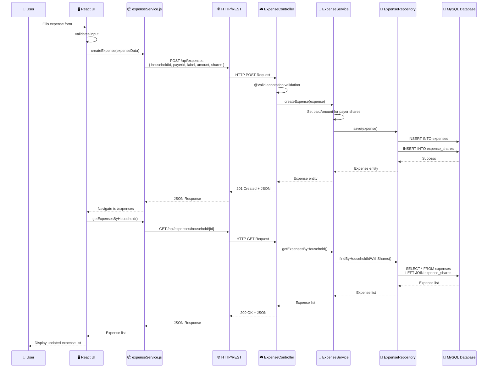
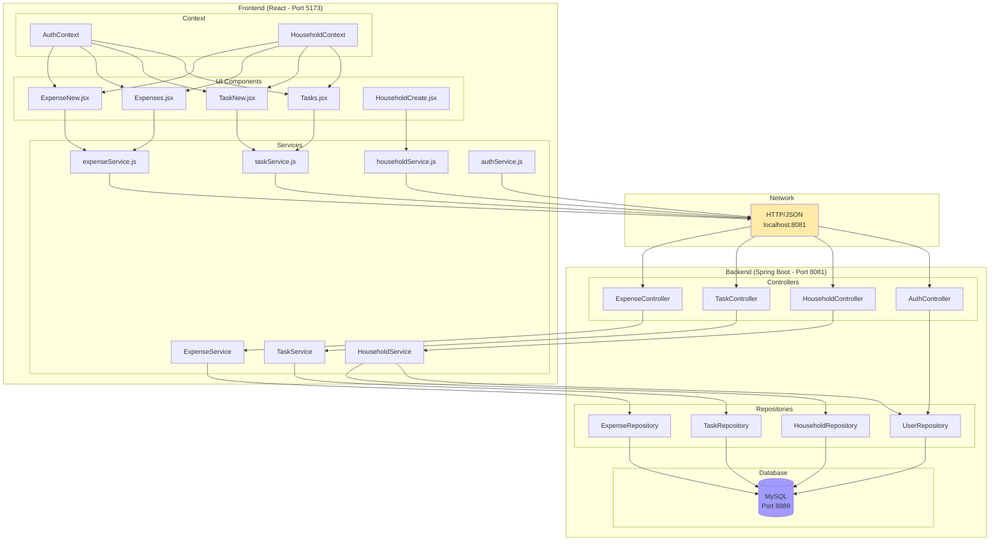
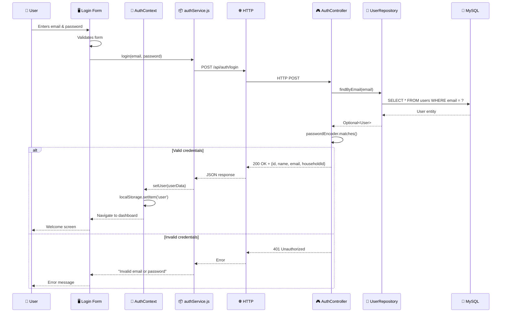
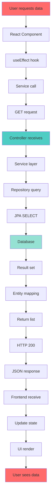
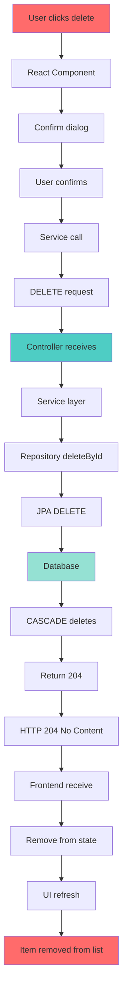
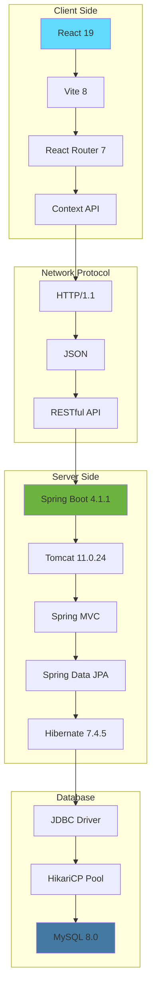
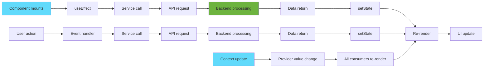

# CoHabit - Application Flow Diagram

## Complete Architecture Flow

```mermaid
graph TB
    subgraph "Frontend Layer (React)"
        A[User Interface] --> B[React Components]
        B --> C[Services Layer]
        C --> D[Context API<br/>Auth & Household]
    end

    subgraph "API Layer (HTTP)"
        E[HTTP Requests<br/>REST API]
    end

    subgraph "Backend Layer (Spring Boot)"
        F[Controllers<br/>REST Endpoints]
        F --> G[Services Layer<br/>Business Logic]
        G --> H[Repositories Layer<br/>Data Access]
        H --> I[JPA/Hibernate<br/>ORM]
    end

    subgraph "Database Layer"
        J[(MySQL Database<br/>MAMP Port 8889)]
    end

    D -->|fetch()| E
    E -->|JSON| F
    F --> G
    G --> H
    H --> I
    I --> J
    J --> I
    I --> H
    H --> G
    G --> F
    F -->|JSON Response| E
    E --> D
    D --> B
    B --> A

    style A fill:#e1f5ff
    style F fill:#fff4e1
    style G fill:#ffe1e1
    style H fill:#e1ffe1
    style J fill:#f0e1ff
```

---

## Data Flow - Create Expense Example



---

## Complete Request-Response Cycle

```mermaid
graph LR
    A[User Action] --> B[React Component]
    B --> C[Form Validation]
    C --> D[Service Call]
    D --> E[HTTP Request]
    E --> F[Spring Boot Server<br/>Port 8081]
    F --> G[Controller]
    G --> H[Service Layer]
    H --> I[Repository]
    I --> J[JPA/Hibernate]
    J --> K[MySQL<br/>Port 8889]
    K --> L[Query Execution]
    L --> M[Result Return]
    M --> N[Entity Mapping]
    N --> O[Repository Return]
    O --> P[Service Processing]
    P --> Q[Controller Response]
    Q --> R[HTTP Response]
    R --> S[JSON Data]
    S --> T[Service Receive]
    T --> U[State Update]
    U --> V[UI Re-render]
    V --> W[User Feedback]

    style A fill:#ff6b6b
    style F fill:#4ecdc4
    style K fill:#95e1d3
    style W fill:#ff6b6b
```



---

## Component Communication Flow



---

## Authentication Flow



---

## CRUD Operations Flow

### CREATE (Create)

```mermaid
graph TD
    A[User fills form] --> B[React Component]
    B --> C[Form validation]
    C --> D[Service call]
    D --> E[POST request]
    E --> F[Controller receives]
    F --> G[@Valid annotation]
    G --> H[Service layer]
    H --> I[Business logic]
    I --> J[Repository save]
    J --> K[JPA INSERT]
    K --> L[Database]
    L --> M[Generated ID]
    M --> N[Return entity]
    N --> O[HTTP 201]
    O --> P[JSON response]
    P --> Q[Frontend receive]
    Q --> R[Update state]
    R --> S[UI refresh]
    S --> T[User sees new item]

    style A fill:#ff6b6b
    style F fill:#4ecdc4
    style L fill:#95e1d3
    style T fill:#ff6b6b
```

### READ (Read)



### UPDATE (Update)

```mermaid
graph TD
    A[User edits item] --> B[React Component]
    B --> C[Form pre-filled]
    C --> D[User modifies]
    D --> E[Form validation]
    E --> F[Service call]
    F --> G[PUT request]
    G --> H[Controller receives]
    H --> I[@Valid annotation]
    I --> J[Service layer]
    J --> K[Business logic]
    K --> L[Repository findById]
    L --> M[Entity exists?]
    M -->|Yes| N[Update fields]
    M -->|No| O[404 Not Found]
    N --> P[Repository save]
    P --> Q[JPA UPDATE]
    Q --> R[Database]
    R --> S[Return updated entity]
    S --> T[HTTP 200]
    T --> U[JSON response]
    U --> V[Frontend receive]
    V --> W[Update state]
    W --> X[UI refresh]
    X --> Y[User sees updated item]

    style A fill:#ff6b6b
    style H fill:#4ecdc4
    style R fill:#95e1d3
    style Y fill:#ff6b6b
```

### DELETE (Delete)



---

## Technology Stack Flow



---

## Error Handling Flow

```mermaid
graph TD
    A[Request fails] --> B{Error type?}
    B -->|Network error| C[Fetch catch]
    B -->|HTTP error| D[Response !ok]
    B -->|Validation error| E[@Valid fails]

    C --> F[Display connection error]
    D --> G{Status code?}
    G -->|400| H[Bad request]
    G -->|401| I[Unauthorized]
    G -->|404| J[Not found]
    G -->|500| K[Server error]

    E --> L[Display validation errors]
    H --> M[Display form errors]
    I --> N[Redirect to login]
    J --> O[Display not found]
    K --> P[Display server error]

    F --> Q[User notification]
    L --> Q
    M --> Q
    N --> Q
    O --> Q
    P --> Q

    style A fill:#ff6b6b
    style Q fill:#ff6b6b
```

---

## State Management Flow



---

## Summary Flow Tables

### Request Lifecycle

| Step | Component | Action | Data Format |
|------|-----------|--------|-------------|
| 1 | React Component | User interaction | - |
| 2 | Service | Prepare request | JavaScript Object |
| 3 | fetch() | HTTP request | JSON string |
| 4 | Spring Boot | Receive request | HTTP + JSON |
| 5 | Controller | Validate & route | Entity/DTO |
| 6 | Service | Business logic | Entity |
| 7 | Repository | Database operation | Entity |
| 8 | JPA/Hibernate | SQL execution | SQL |
| 9 | MySQL | Data persistence | Table rows |
| 10 | MySQL | Return result | Result set |
| 11 | JPA/Hibernate | Map to Entity | Entity |
| 12 | Repository | Return to Service | Entity |
| 13 | Service | Process result | Entity/DTO |
| 14 | Controller | Prepare response | JSON |
| 15 | Spring Boot | HTTP response | JSON string |
| 16 | fetch() | Receive response | JavaScript Object |
| 17 | Service | Update state | JavaScript Object |
| 18 | React Component | Re-render | UI |

### Technology Ports

| Layer | Technology | Port | Purpose |
|-------|-----------|------|---------|
| Frontend | Vite Dev Server | 5173 | React application |
| Backend | Spring Boot/Tomcat | 8081 | REST API |
| Database | MySQL (MAMP) | 8889 | Data storage |
| Network | HTTP | 80/443 | Communication protocol |

### Data Formats

| Layer | Format | Example |
|-------|--------|---------|
| Frontend State | JavaScript Object | `{ name: "John", age: 25 }` |
| HTTP Request | JSON String | `'{"name":"John","age":25}'` |
| Backend Entity | Java Object | `User(name="John", age=25)` |
| Database | Table Row | `id=1, name='John', age=25` |
| HTTP Response | JSON String | `'{"id":1,"name":"John","age":25}'` |
