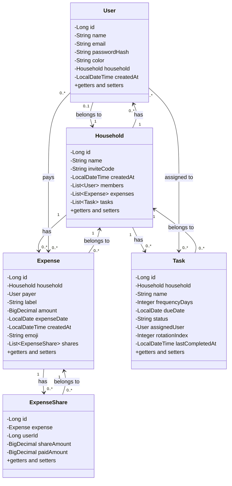
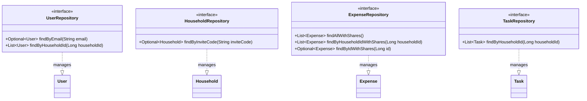
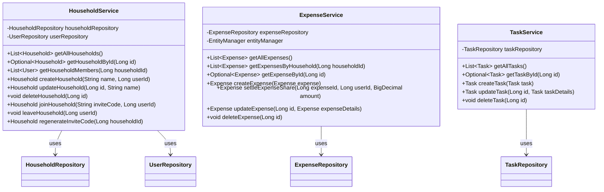
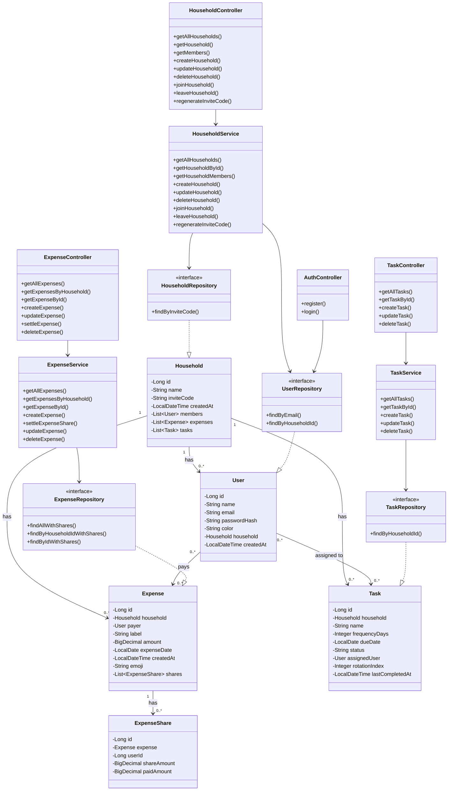

# CoHabit Class Diagram

## Entity Layer

## Repository Layer

## Service Layer

## Controller Layer

```mermaid
classDiagram
    class AuthController {
        -UserRepository userRepository
        -PasswordEncoder passwordEncoder
        +ResponseEntity~?~ register(Map~String, String~ payload)
        +ResponseEntity~?~ login(Map~String, String~ payload)
    }

    class HouseholdController {
        -HouseholdService householdService
        +List~Map~String, Object~~ getAllHouseholds()
        +ResponseEntity~?~ getHousehold(Long householdId)
        +List~Map~String, Object~~ getMembers(Long householdId)
        +ResponseEntity~?~ createHousehold(Map~String, Object~ payload)
        +ResponseEntity~?~ updateHousehold(Long householdId, Map~String, Object~ payload)
        +ResponseEntity~?~ deleteHousehold(Long householdId)
        +ResponseEntity~?~ joinHousehold(Map~String, Object~ payload)
        +ResponseEntity~?~ leaveHousehold(Map~String, Object~ payload)
        +ResponseEntity~?~ regenerateInviteCode(Long householdId, Map~String, Object~ payload)
    }

    class ExpenseController {
        -ExpenseService expenseService
        +List~Expense~ getAllExpenses()
        +List~Expense~ getExpensesByHousehold(Long householdId)
        +ResponseEntity~Expense~ getExpenseById(Long id)
        +Expense createExpense(@Valid Expense expense)
        +ResponseEntity~?~ updateExpense(Long id, @Valid Expense expense)
        +ResponseEntity~?~ settleExpense(Long id, Map~String, Object~ payload)
        +ResponseEntity~Void~ deleteExpense(Long id)
    }

    class TaskController {
        -TaskService taskService
        +List~Task~ getAllTasks()
        +ResponseEntity~Task~ getTaskById(Long id)
        +Task createTask(@Valid Task task)
        +ResponseEntity~Task~ updateTask(Long id, @Valid Task task)
        +ResponseEntity~Void~ deleteTask(Long id)
    }

    AuthController --> UserRepository : uses
    HouseholdController --> HouseholdService : uses
    ExpenseController --> ExpenseService : uses
    TaskController --> TaskService : uses
```

## Complete Architecture Overview

## Entity Relationships Summary

### Household (Foyer)
- **Has many** Users (members)
- **Has many** Expenses
- **Has many** Tasks
- **Has unique** inviteCode

### User (Utilisateur)
- **Belongs to** one Household (optional)
- **Pays** many Expenses
- **Assigned to** many Tasks
- **Has unique** email

### Expense (Dépense)
- **Belongs to** one Household
- **Paid by** one User
- **Has many** ExpenseShares (for splitting)

### ExpenseShare (Part de dépense)
- **Belongs to** one Expense
- **For** one User
- **Has** shareAmount and paidAmount

### Task (Tâche)
- **Belongs to** one Household
- **Assigned to** one User (optional)
- **Has** frequency, dueDate, status

## REST API Endpoints Mapping

| Controller | HTTP Method | Endpoint | CRUD Operation |
|-----------|-------------|----------|----------------|
| AuthController | POST | /api/auth/register | Create User |
| AuthController | POST | /api/auth/login | Read/Authenticate |
| HouseholdController | GET | /api/households | Read All |
| HouseholdController | GET | /api/households/{id} | Read One |
| HouseholdController | POST | /api/households | Create |
| HouseholdController | PUT | /api/households/{id} | Update |
| HouseholdController | DELETE | /api/households/{id} | Delete |
| ExpenseController | GET | /api/expenses | Read All |
| ExpenseController | GET | /api/expenses/{id} | Read One |
| ExpenseController | POST | /api/expenses | Create |
| ExpenseController | PUT | /api/expenses/{id} | Update |
| ExpenseController | DELETE | /api/expenses/{id} | Delete |
| TaskController | GET | /api/tasks | Read All |
| TaskController | GET | /api/tasks/{id} | Read One |
| TaskController | POST | /api/tasks | Create |
| TaskController | PUT | /api/tasks/{id} | Update |
| TaskController | DELETE | /api/tasks/{id} | Delete |

## Data Types Used

- **Long**: IDs (Primary keys)
- **String**: Names, emails, passwords, codes, labels
- **BigDecimal**: Monetary amounts (12,2 precision)
- **LocalDate**: Dates (no time)
- **LocalDateTime**: Timestamps
- **Integer**: Numeric values (frequency, rotation index)
- **List<T>**: Collections (One-to-Many relationships)
- **Optional<T>**: Nullable return types
